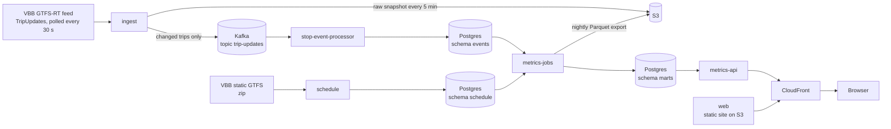

# System architecture

How berlin-transit-pulse is built, what each part is for, what was chosen over what, and what
is built today versus planned. Product scope is in [`spec.md`](spec.md), delivery in
[`plan.md`](plan.md), individual decisions in [`adr/`](adr/README.md).

Status as of 2026-11-20: milestone M1 is nearly done (local walking skeleton). Nothing is
deployed to AWS yet. Every component below is marked **Built** or **Planned** with its issue.

## Overview

One small AWS server runs everything as Docker containers: a single-broker Kafka, Postgres and
the services. Realtime updates flow left to right through Kafka into Postgres. Whatever has to
outlive the server (raw snapshots, Parquet history, backups) goes to S3. CloudFront serves the
site and absorbs traffic. Each choice favours one small, explainable component over a platform.

## Design rules

The rules the architecture depends on. The full, enforced list is in
[`CLAUDE.md`](../CLAUDE.md) (written for AI coding assistants, and equally binding on people).

- **Service boundaries.** One folder per service under `services/`. A service never imports
  another service's code. Shared code lives in `libs/` and stays small. Services talk only
  through Kafka topics or the metrics API. Message schemas live in [`schemas/`](../schemas/README.md).
- **One schema and one role per service** in the shared Postgres. The API uses a read-only role.
- **Idempotent writes.** Stop events are keyed by (`trip_id`, `service_date`, `stop_sequence`).
  Replaying a topic or re-running a job gives the same tables. There is no exactly-once
  guarantee; correctness comes from idempotent keys.
- **Time.** Store UTC. Use Europe/Berlin only for GTFS service-day logic and display. GTFS times
  can exceed 24:00 and are never parsed as clock times.
- **Show gaps, not guesses.** Every figure on the site comes from the pipeline. Hours with data
  coverage below a threshold are shown as gaps.
- **Feed etiquette** (rate limit, gzip, ETag, User-Agent, no live calls in tests):
  [data sources](data-sources.md#rules-for-using-the-feed).
- **Optional work stays off the release path.** Code under `alt/`,
  `deploy/terraform/aws-microservices/` and `deploy/terraform/eks/` is never imported or required
  by the release ([alternatives](alternatives.md)).

## Services

The code is split into microservices from the start. Each service is its own container with its
own Dockerfile and tests, owns its own data and talks to the others only through Kafka topics
or its API. The same images run on every deployment target, so the release server and the
proof of concept differ only in their Terraform.

| Service | Owns | Reads from → writes to | Status |
| --- | --- | --- | --- |
| [`ingest`](../services/ingest/README.md) | Polling, diffing, raw snapshots | VBB feed → Kafka `trip-updates`; S3 | **Built** (#6, #7): poll, validate, diff, publish. Raw snapshots to S3: planned M2 (#19) |
| [`stop-event-processor`](../services/stop-event-processor/README.md) | Turning predictions into finalised stop events | Kafka → Postgres `events` | **Skeleton built** (#8): latest prediction per trip and stop, idempotent. Finalisation with a grace window: planned M3 (#22, #23) |
| [`schedule`](../services/schedule/README.md) | Static GTFS import, versions, Berlin and mode flags | VBB static zip → Postgres `schedule` | **Built** (#5): versioned import with atomic swap. Weekly refresh and pruning: planned M3 (#24) |
| [`metrics-jobs`](../services/metrics-jobs/README.md) | Metric models, data-quality checks, Parquet export | Postgres `events`, `schedule` → Postgres `marts`; S3 | **Started** (#9): two plain SQL views. Data quality M3 (#25), metrics M3 (#29), dbt M4 (#32), Parquet M4 (#34) |
| [`metrics-api`](../services/metrics-api/README.md) | Read-only HTTP API for the UI | Postgres `marts` (read-only role) | **Built** (#9): `/health`, `/v1/now/by-mode`. History endpoints: planned M4 (#35) |
| [`web`](../web/) | Static, mobile-first commuter UI | metrics-api, through CloudFront | **Started** (#10): one live page (plain HTML, CSS, JS) served by nginx in compose, `/api/` proxied to metrics-api. Full UI M4 (#36, #37, #38) |
| `libs/common` | Settings, JSON logging, fixture loading | n/a | **Built** |

## Technology choices

Each row records the chosen design, what was rejected and the trade-off accepted. It states
the design, not what is built today: the [services table](#services) has the status. Where an
ADR is planned, the row says which; accepted ADRs are linked.

| Layer | Choice | Rejected alternatives | Trade-off |
| --- | --- | --- | --- |
| **Ingestion** | Python poller (`httpx`) every 30 s with gzip, ETag and a User-Agent with contact details. Diffs each snapshot against the previous one and publishes only changed trips. Raw snapshot to S3 every 5 minutes. *Planned ADR-0003, ADR-0008* | Publishing every stop update (about 206,000 per poll); a Lambda poller | Diffing cuts Kafka traffic to a few thousand messages per poll. One process is one point of failure; the container restart policy restarts it, and a restart republishes every trip as `new` |
| **Streaming** | Apache Kafka in KRaft mode (no ZooKeeper), single broker, heap about 384–512 MB. Topic `trip-updates` keyed by trip ID and service date, 6 partitions, 24 h retention ([contract](../schemas/trip-updates.md)). *Planned ADR-0002* | MSK (about $67+ per month); Redpanda (memory-hungry); NATS JetStream; Redis Streams | A widely used log: consumers can be replayed and added independently. No replication; a production version would need it |
| **Stream processing** | Python consumer (`confluent-kafka`) that turns predictions into observed stop events: keeps the latest prediction per (trip, stop) and finalises it once the stop time plus a grace window has passed. Idempotent upserts. *Planned ADR-0004* | Flink, Spark Structured Streaming, Faust, Bytewax | Plain Python is easy to test with recorded feeds. No exactly-once guarantee, so correctness comes from idempotent keys |
| **Static schedule** | Import of VBB's static GTFS into a versioned Postgres schema, swapped atomically; weekly refresh. [ADR-0009](adr/0009-version-static-gtfs-and-swap-atomically.md), [ADR-0017](adr/0017-define-berlin-and-mode-from-stop-ids-and-route-types.md) | Querying the zip on the fly; truncate and reload | Needs a tested refresh path before the 2026-12-13 timetable change. About 1 GB of Postgres per kept version |
| **Hot storage** | Postgres 16 in Docker: stop events partitioned by day with 30 days of retention, aggregate tables, data-quality results. *Planned ADR-0006* | RDS (optional while credits last); DynamoDB (wrong fit for joins and aggregations); TimescaleDB | Cheapest and fully under the project's control. The project owns backups (nightly `pg_dump` to S3) |
| **History** | Nightly export of finalised stop events to Parquet in S3, partitioned by date and mode; DuckDB for analysis and charts. *Planned ADR-0007* | Iceberg, Athena, Redshift | Cheap and portable, and it is the archive that survives a shutdown. No ACID table format, which is fine for append-only daily files |
| **Transformation** | `dbt-core` with `dbt-postgres` for hourly and daily aggregates, with dbt tests (M4). Plain SQL views until then | Hand-written SQL scripts; Spark | Modelling and testing discipline at low cost. One more tool to maintain. Falls back to plain SQL if the schedule slips ([cut list](plan.md#cut-list)) |
| **Orchestration** | systemd timers on the host: dbt runs, Parquet export, GTFS refresh, backups. *Planned ADR-0011* | Airflow, Dagster, Step Functions | Fits in 2 GB and is easy to explain. No UI: job status is visible through metrics and alarms |
| **Data quality** | Checks on every poll and every hour, results stored and shown on a status page ([below](#data-quality)). *Planned ADR-0010* | Great Expectations, Soda | Lightweight and specific to this feed. Hand-written, so each check needs a test |
| **Monitoring and alerts** | App metrics to CloudWatch (within the free allowance of 10 custom metrics), alarms to email through SNS, healthchecks.io dead-man's switch for the poller, Kafka consumer lag as a metric | Prometheus and Grafana on the box (too much RAM) | Nearly free and AWS-native. Less visual than Grafana, so the status page is the human-facing view |
| **API** | FastAPI, read-only, serving precomputed aggregates with cache headers | Querying raw events per request | Fast and cheap; CloudFront absorbs traffic spikes |
| **Dashboard** | Mobile-first static frontend on S3 and CloudFront: line search, "Right now vs normal", hour-by-weekday heatmap, network overview | Grafana as the public UI; Streamlit | A UI built for commuters rather than analysts, at the price of more frontend work |
| **Infrastructure and delivery** | Terraform (EC2, S3 with lifecycle rules, IAM, CloudFront, SNS, Budgets); GitHub Actions (tests, arm64 images to GHCR, `terraform plan`); deploys through SSM Run Command. *Planned ADR-0012* | CDK; deploys over SSH | Reproducible, and no open SSH port |
| **Service boundaries** | Microservices, one schema and one database role per service in a shared Postgres. *Planned ADR-0014* | One database per service | A pragmatic step short of a database per service, which a 2 GB host cannot carry |

## Data stores

### Kafka

One topic, `trip-updates`, created only by the `kafka-init` container (auto-creation is off, so
a misspelt name fails). Six partitions, replication 1, 24 h retention, cleanup `delete`. Key,
value, headers and delivery guarantees are in [`schemas/trip-updates.md`](../schemas/trip-updates.md).
Changing a topic needs an ADR and an explicit alter on every stack
([compose README](../deploy/compose/README.md)). A dead-letter topic is part of the design and
does not exist yet.

### Postgres

One database, `btp`, with one schema and one role per writing service. Created by
[`01_schemas_roles.sql`](../deploy/compose/postgres/init/01_schemas_roles.sql).

| Schema | Role | Content | Written by |
| --- | --- | --- | --- |
| `schedule` | `btp_schedule` | Every imported static GTFS version; consumers read the `schedule.v_*` views of the active version | schedule |
| `events` | `btp_processor` | `trip_state`, `stop_predictions`; later finalised stop events | stop-event-processor |
| `marts` | `btp_metrics_jobs` | Views and later dbt models; read by the API | metrics-jobs |

`btp_metrics_jobs` can also read `events` and `schedule`. `btp_api` reads only `marts`. ingest
does not use Postgres. Details: [compose README](../deploy/compose/README.md#schemas-and-roles).

### S3

| Prefix | Content | Retention |
| --- | --- | --- |
| Raw snapshots | One feed snapshot every 5 minutes (about 2.3 MB each) | 14 days, by lifecycle rule (about 9 GB stored) |
| Parquet history | Finalised stop events, partitioned by date and mode | Kept; grows about 1–3 GB per month |
| Backups | Nightly `pg_dump` (#28) | Not decided yet |

Terraform state lives in its own bucket (#13).

## How the pieces behave

### From prediction to observed stop event (M3)

The feed carries predictions. The processor already keeps the latest prediction for each
(trip, service date, stop sequence). In M3 it finalises a stop event once the stop time plus a
grace window has passed, using the last prediction before the stop time as the "observed"
time. Cancellations arrive as updates with `schedule_relationship: CANCELED` and are not the
same as a trip disappearing from the feed. The grace window length, and how late and duplicate
updates are handled, are decided in planned ADR-0004 and covered by edge-case tests (#23):
duplicates, late updates, vanished trips, trips after midnight, daylight-saving changes.

### Matching realtime to the schedule

Realtime updates carry only trip and stop IDs. Line names, modes, stop names and the Berlin
flag come from the static GTFS. Realtime stop updates are matched to the schedule by
`stop_sequence` within the trip, not by `stop_id`, because some realtime stop IDs do not exist
in the static data ([data sources](data-sources.md#behaviour-to-know-before-touching-the-data)).

### Static schedule versions

Each static GTFS zip becomes one version in `schedule`. Consumers read only views of the single
active version, so a swap is atomic, a failed import leaves the active version untouched and a
rollback is one command. After a timetable change trip IDs change, so a trip is only found in
the version it belongs to. See [ADR-0009](adr/0009-version-static-gtfs-and-swap-atomically.md).
"In Berlin" is decided per trip by a `de:11000:` stop ID prefix and the mode by route type
([ADR-0017](adr/0017-define-berlin-and-mode-from-stop-ids-and-route-types.md)).

### Live views and the reference time

Views that mean "now" read the session setting `btp.as_of` and fall back to `now()`. This lets
the recorded fixtures show the rush hour they were recorded in
([ADR-0019](adr/0019-pin-the-reference-time-of-live-views-with-a-session-setting.md)).

## Deployment targets

The same container images run on all of these.

| Target | Runs on | Lifecycle | Cost |
| --- | --- | --- | --- |
| **Local** | `docker compose` on a developer machine; fixtures replace the live feed | Any time | none |
| **Release** | `docker compose` on one EC2 t4g.small (2 vCPU, 2 GB RAM, arm64), Terraform in `deploy/terraform/release` | Live from M2 | about $21 per month ([cost](cost.md)) |
| **Microservices proof of concept** | ECS Fargate (one service per container), MSK Serverless, RDS Postgres, an Application Load Balancer, public subnets and no NAT gateway; `deploy/terraform/aws-microservices` | `terraform apply`, run a few hours against the live feed, capture screenshots and metrics, `terraform destroy` | about $1 per hour, $4–6 per run (estimate) |
| **Kubernetes reference** | Helm chart tested on a local `kind` cluster in CI; EKS Terraform module checked with `terraform plan` only | Never deployed | $0 |

The release stack is the product. The proof of concept and the Kubernetes reference are part of
the optional [alternatives track](alternatives.md).

All regional AWS resources are in `eu-north-1` (Stockholm), see
[ADR-0018](adr/0018-use-eu-north-1-and-an-iam-user-with-aws-login.md) and
[`aws-account.md`](aws-account.md).

## Memory budget

The release server has 2 GB of RAM. The design target:

| Component | Budget |
| --- | --- |
| Kafka | about 500 MB |
| Postgres | about 400 MB |
| Python services | about 400 MB |
| Operating system | about 300 MB |
| Swap | 2 GB |

Measured so far, on a development machine in fixtures mode (2026-11-19): about 800 MB in total
(Kafka about 568 MB, Postgres about 110 MB, metrics-api about 48 MB, ingest and processor about
33 and 46 MB). The compose container limits add up to 1,984 MB for the long-running services,
which is a ceiling, not a use. **Not yet measured on the real t4g.small** (#20, M2). If it does
not fit, the fallback is a t4g.medium (about +$17 per month) or moving Postgres off the box.
Every new service needs a limit that fits next to the others.

## Data quality

Checks run on every poll and every hour. Results are stored and shown on a status page
(#25, M3).

| Check | Threshold |
| --- | --- |
| Feed age | Under 2 minutes |
| Entity count | Within the expected range for that hour |
| Schedule match rate | At least 95% of trips matched to the schedule |
| Delay plausibility | Between −10 and +180 minutes |
| Duplicate keys | None |

The 2-minute feed age is a starting value: a header 448 s old was seen at night on 2026-11-19
([troubleshooting](troubleshooting.md#feed-header-several-minutes-old-at-night)). Tune it with
24/7 data before alerting on it. The same checks run in CI on the recorded fixtures.

## Observability and alerting

- **Logs:** one JSON line per event through `btp_common` (a `poll` and `publish` line per
  snapshot in ingest, a line per batch in the processor, request logs in the API).
- **Metrics and alarms (M3):** application metrics to CloudWatch, alarms to email through SNS
  (#26). Alarms: feed stale, schedule match rate dropped, consumer lag, disk and memory.
- **Dead-man's switch (M3):** healthchecks.io notices when the poller stops (#27).
- **Status page (M3):** the human-facing view of data-quality results and per-mode coverage.
- **Health endpoint:** `/health` on the API returns 503 when the database is unreachable or the
  newest feed data is older than 5 minutes.

A runbook (deploy, roll back, restore, shut down) is created with the release stack in M2.

## Security and access

- **No SSH.** The release server is reached through SSM Run Command. GitHub Actions
  authenticates with OIDC (M2); there are no long-lived access keys anywhere
  ([`aws-account.md`](aws-account.md)).
- **Network.** In compose, Kafka, Postgres and the API bind to `127.0.0.1` only, so they are not
  exposed on a public interface whatever the security group says. How the API reaches
  CloudFront is decided with the release stack (#15, #17).
- **Database access.** One role per service, each owning its own schema; the API role is
  read-only.
- **Secrets.** Compose uses development passwords. The release stack replaces them with real
  secrets in M2; the mechanism is not decided yet. No secrets in the repository.
- **Infrastructure changes.** Everything comes from Terraform, tagged `Project`, `Stack` and
  `ManagedBy`. A human maintainer applies after reading the plan; AI coding agents never run
  `terraform apply` or `terraform destroy`.
- **Dependencies.** Dependabot proposes grouped weekly updates for GitHub Actions and the uv
  lockfile.

## Infrastructure and delivery

- **CI** (GitHub Actions, on every push and pull request): lint (`ruff`), type check (`mypy`
  strict, per package), unit tests with coverage, and a build of every service's Docker image.
  CI never calls the live feed.
- **CD (M2, #18):** build arm64 images to GHCR and deploy through SSM Run Command. Terraform
  plans run in CI; the apply is manual.
- **Rebuild from zero:** the whole stack must be rebuildable with Terraform in under 30 minutes,
  and the drill is timed in M5 (#41). Together with the nightly `pg_dump` and the Parquet
  history in S3, this is the recovery plan for instance or disk loss.
- **Releases:** tags `v0.1` (M1) to `v1.0` (M5) with a GitHub Release each.

## Repository layout

| Path | Content | Status |
| --- | --- | --- |
| `services/` | `ingest`, `stop-event-processor`, `schedule`, `metrics-jobs`, `metrics-api` | Built |
| `libs/common/` | Shared settings, logging, fixture loading | Built |
| `schemas/` | Kafka message contracts | Built |
| `fixtures/` | Recorded feed snapshots and a mini static GTFS, shared by all tests | Built |
| `scripts/` | Fixture recording and trimming | Built |
| `deploy/compose/` | The compose stack (local and release) | Built |
| `web/` | Commuter UI | Minimal page (M1) |
| `deploy/terraform/release/` | EC2 release stack, applied | Planned (M2) |
| `deploy/terraform/aws-microservices/` | Proof of concept, applied then destroyed | Planned (alternatives) |
| `deploy/terraform/eks/` | EKS module, plan only | Planned (alternatives) |
| `helm/transit/` | Helm chart, tested on `kind` in CI | Planned (alternatives) |
| `alt/` | Alternative implementations (`flink/`, `iceberg/`, `otel/`, `dagster/` and so on) | Planned (alternatives) |
| `docs/` | This documentation ([index](README.md)) | Built |

## Known limitations

These are accepted for v1 and documented here so a reviewer does not have to find them.

- **No high availability.** One broker, one database, one ingest process. A production version
  would need a replicated Kafka cluster, a managed database and multiple availability zones.
- **No replication or exactly-once.** Ingest keeps its diff state in memory: after a restart the
  first snapshot publishes every trip as `new` (about 10,000 messages), and removals that
  happened while it was down are never published. Consumers are idempotent.
- **Observed is not measured.** The "observed" time is the last prediction before the stop time,
  not a sensor reading of the arrival.
- **Static schedule size.** Every kept version costs about 1 GB of Postgres disk. Pruning
  retired versions is not built yet (#24).
- **Early staging of a timetable.** Validation requires the feed's date range to cover today, so
  the timetable starting on 2026-12-13 cannot be staged as `ready` earlier. #24 decides how to
  handle this.
- **Fixtures expire.** The mini static GTFS fixture's calendar ends on 2027-12-11.
- **No retention yet** on the `events` tables (M3).

## Design points not yet decided or built

- Dead-letter topic for messages that cannot be processed.
- Whether the schedule service announces new versions on a Kafka topic (the original plan had
  it; no such topic exists).
- Length of the stop-event grace window (planned ADR-0004).
- Secrets mechanism on the release host.
- How the API is exposed to CloudFront.
- The coverage threshold below which an hour is shown as a gap (planned ADR-0010).

## Planned ADRs

Sixteen ADRs were planned up front, and four exist (ADR-0009 and ADR-0017 to ADR-0019).
[`adr/README.md`](adr/README.md) lists each with its status, the section of these docs that
holds its rationale today, and the milestone that writes it.
